# PenPlot — the world's first all-in-one browser CNC plotter

**Image → SVG → G-code → CAM — in one web app. No install. Any device. Any OS.**

[](https://adithya-in.github.io/penplot/)
[](https://github.com/adithya-in/penplot/releases/tag/v1.1)
[](#firmware-provenance-and-licence)

PenPlot turns a **photo, logo, SVG or text** into a finished pen drawing on a
GRBL CNC plotter. The entire pipeline — raster-to-vector tracing, vector
toolpath generation, G-code export and live machine CAM — runs **inside the
browser**. There is no backend, no account, no cloud conversion and no local
Python/Node server needed for the hosted app.


```text
photo / logo / SVG / text
        │
        ▼
  stroke extraction            ← image tracing, Bézier flattening, Hershey font
        │
        ▼
  toolpath optimisation        ← clipping, ordering, pen-up travel
        │
        ▼
  G-code + preview             ← live canvas simulation, statistics, SVG export
        │
        ▼
  Web Serial → GRBL → motors   ← jog, zero, pen lift, pause/resume/stop
```

To our knowledge, this is the **first CNC plotter project that combines all four
stages — image → SVG, SVG → G-code, G-code CAM and live machine control — in a
single browser app that runs on any device or operating system**. The same UI
works on a Windows laptop, a Mac, a Linux box, a Chromebook, an Android tablet
or an iPad: you can design, preview and export anywhere. Only the final USB
streaming step is limited to browsers that expose Web Serial (desktop Chrome and
Edge), which is a browser API limit, not an app or OS limit.

---

## Contents

1. [The machine](#the-machine)
2. [Screenshots](#screenshots)
3. [Feature matrix](#feature-matrix)
4. [The pipeline in code](#the-pipeline-in-code)
5. [Compatibility](#compatibility)
6. [Quick start](#quick-start)
7. [What you need](#what-you-need)
8. [Wiring](#wiring)
9. [Flash the Nano](#flash-the-nano)
10. [First-run workflow](#first-run-workflow)
11. [Drawing modes](#drawing-modes)
12. [Settings and calibration](#settings-and-calibration)
13. [Machine controls and console](#machine-controls-and-console)
14. [Troubleshooting](#troubleshooting)
15. [Safety](#safety)
16. [Project layout](#project-layout)
17. [Firmware provenance and licence](#firmware-provenance-and-licence)

---

## The machine

PenPlot running on the reference build: an Arduino Nano with a CNC shield,
three ULN2003 driver boards, three 28BYJ-48 steppers and a 3D-printed
rack-and-pinion gantry. The Nano runs the GRBL build in [`firmware/`](firmware/),
and the browser drives it over Web Serial.

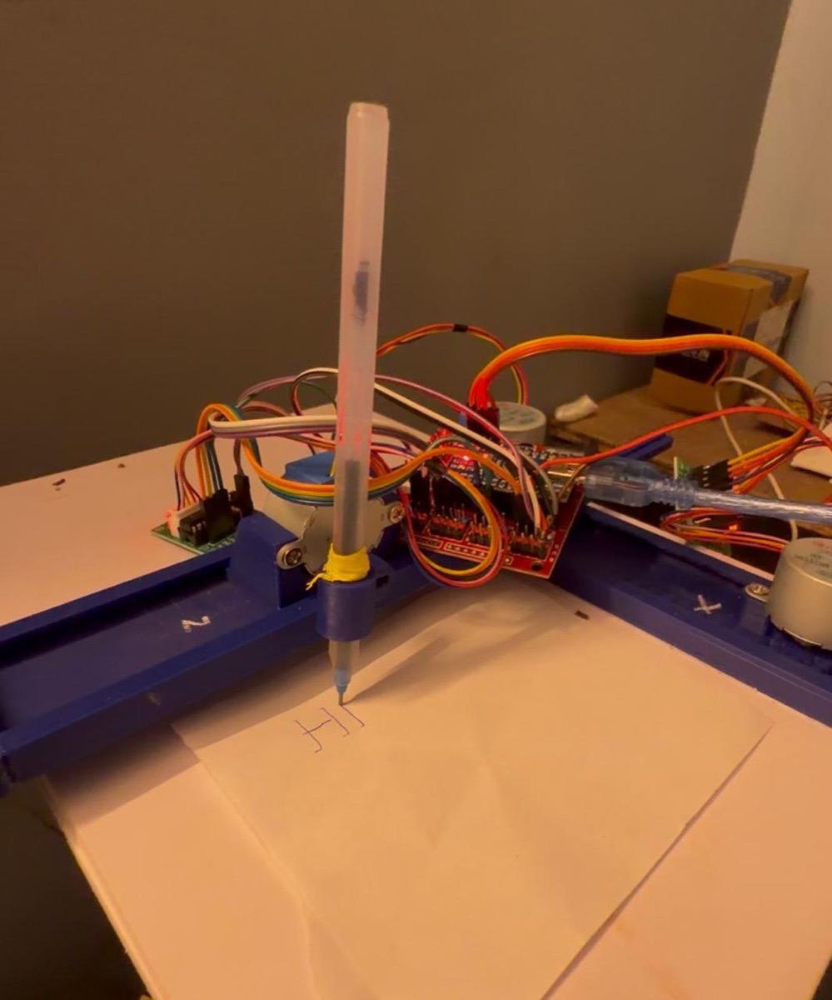

The `HI` on the paper is one job from the text tool, with the pen lift on Z.

| Electronics | Mid-job |
| --- | --- |
| 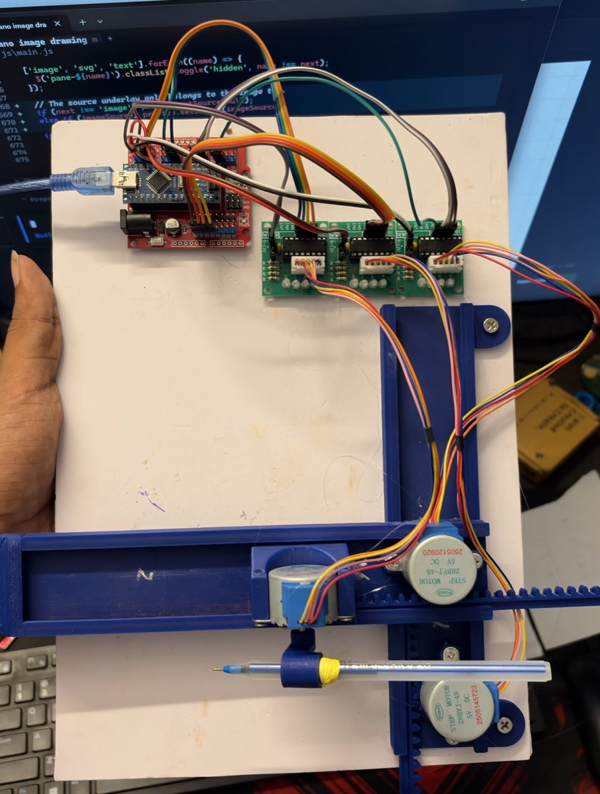 | 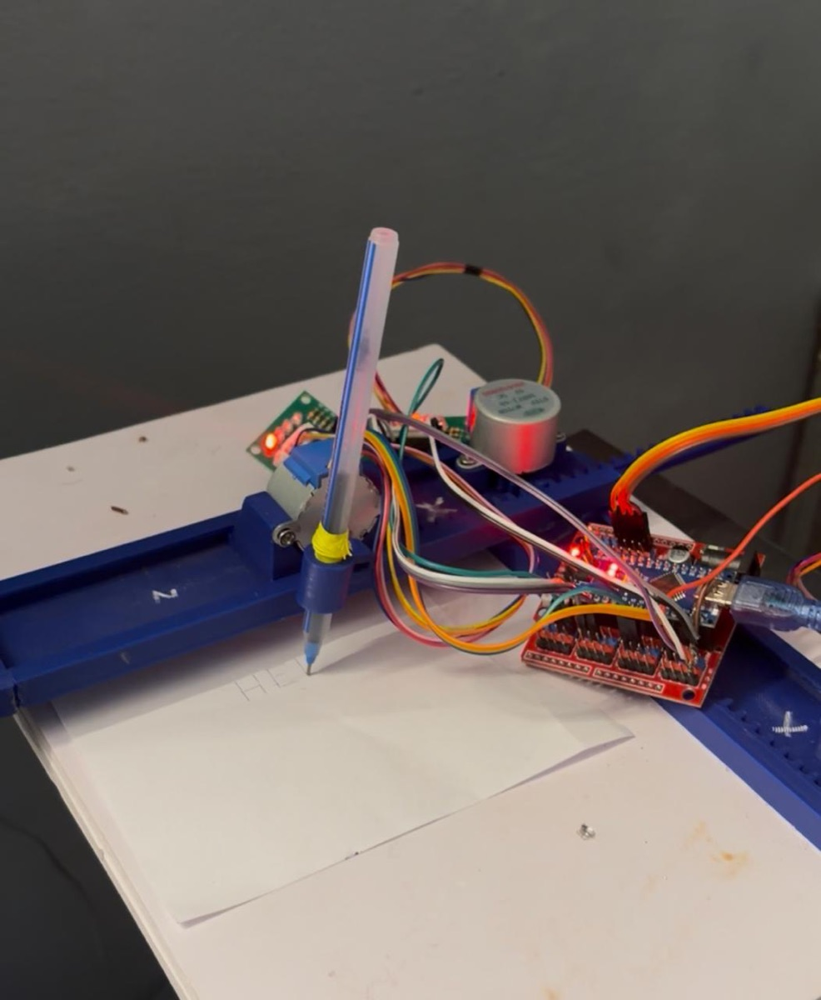 |
| Nano + CNC shield, three ULN2003 boards, 28BYJ-48 steppers | The red LEDs show the coils being energised as the toolpath streams |

These are unedited phone photos — the wiring is still on the bench, not in an
enclosure.

---

## Screenshots

Every screenshot below is generated with Playwright from the real app
(`npm run screenshots`) and committed in [`docs/screenshots`](docs/screenshots).

### 1. The workspace

Three columns: **source controls** on the left, the **live canvas preview** in
the centre, and **machine/settings/console** on the right. The canvas shows the
toolpath, the paper, the image underlay and the live crosshair.


### 2. Image → SVG → G-code (Sketch / Squiggle)

Drop a photo and PenPlot traces it into one continuous wavy line per row. Dark
pixels get a larger amplitude; light areas flatten out. The source image stays
visible under the toolpath so you can judge the fit before drawing.

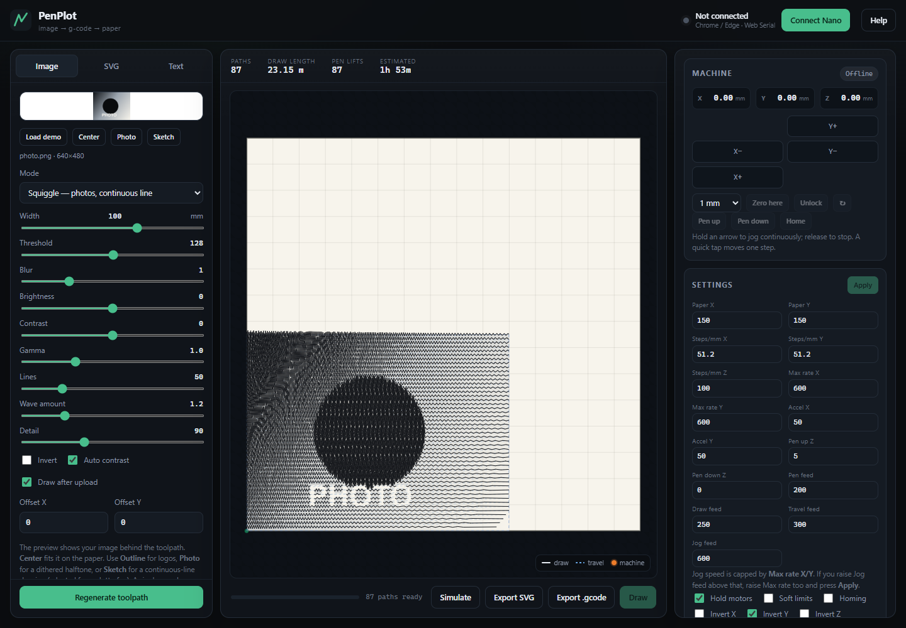

### 3. Photo halftone

Press **Photo** for a scan-line + dither halftone: the single pen builds greys
from black dots and short strokes. This is the photographic mode, at the cost of
many more pen lifts than Sketch.

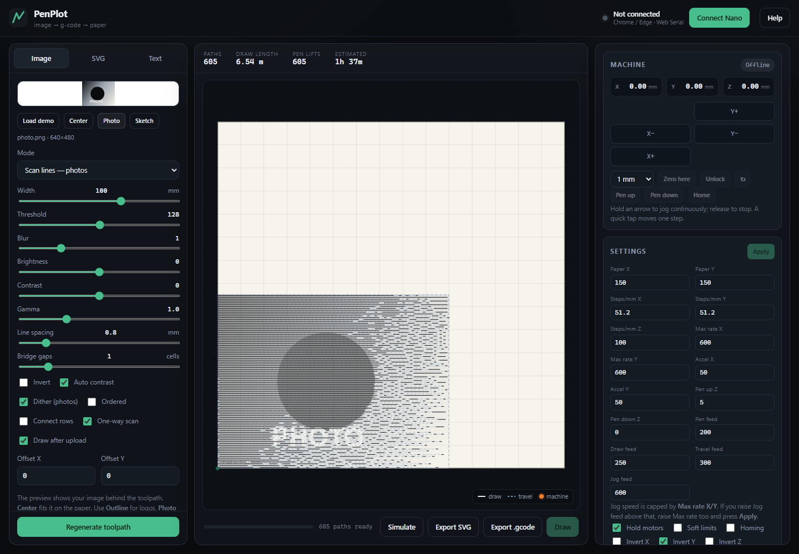

### 4. Image controls

Mode, width, tone, dithering, spacing, simplification and row linking are all
live: change a slider and the toolpath regenerates in the browser.

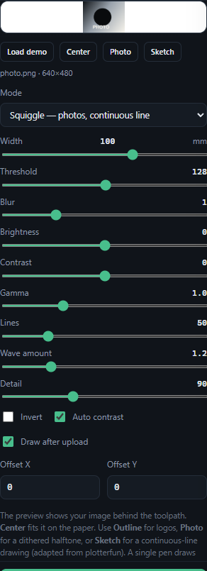

### 5. SVG import

SVG paths, shapes, polylines, polygons and lines are imported, transforms and
Bézier curves are flattened, then the result is scaled to a physical width in
millimetres. Fills are plotted as outlines.

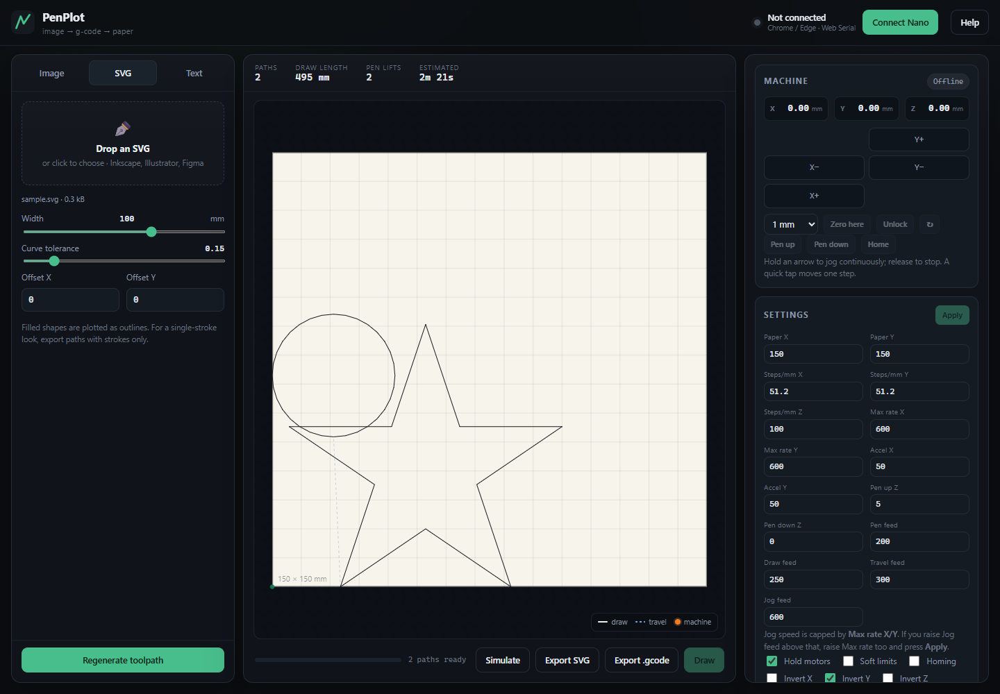

### 6. Text

A single-stroke Hershey font draws letters in one pass, like a technical pen,
with height, spacing, alignment and rotation controls.

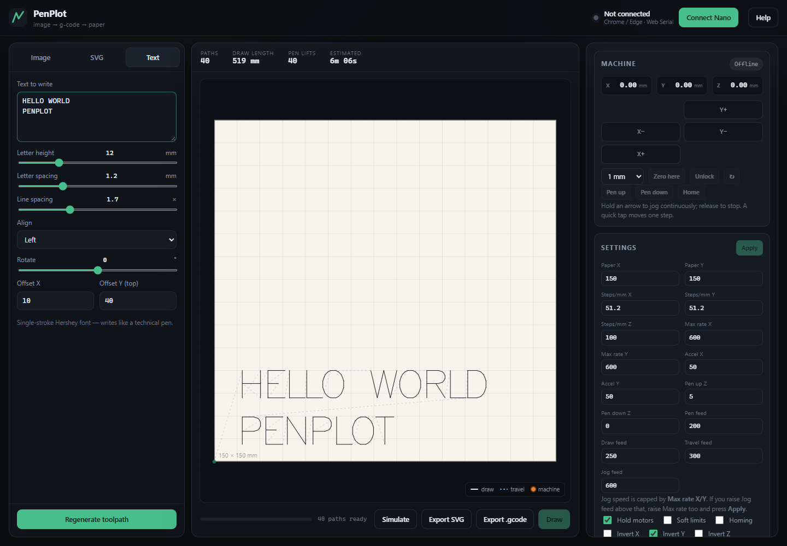

### 7. Simulation and CAM

**Simulate** plays the whole job on the canvas without moving the machine. The
stats bar shows paths, draw length, pen lifts and estimated time. **Export SVG**
and **Export .gcode** download the result for any other CAM tool.

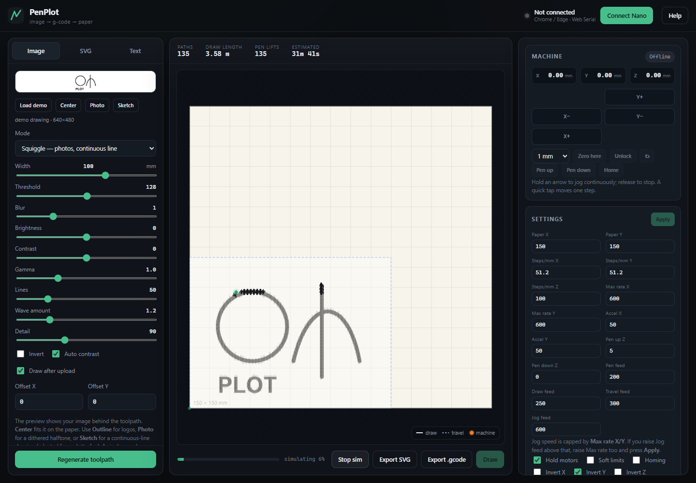

### 8. Machine controls

Hold-to-jog arrows, step selection, zero, unlock, pen up/down and the raw GRBL
console. The orange crosshair tracks the real machine position in work
coordinates (`WPos`).

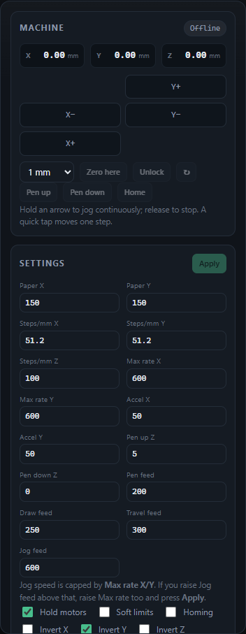

### 9. Settings and calibration

Paper size, steps/mm, max rate, acceleration, pen heights, feeds, motor hold,
soft limits, homing and per-axis inversion — persisted in the browser and
written to GRBL EEPROM with **Apply**.

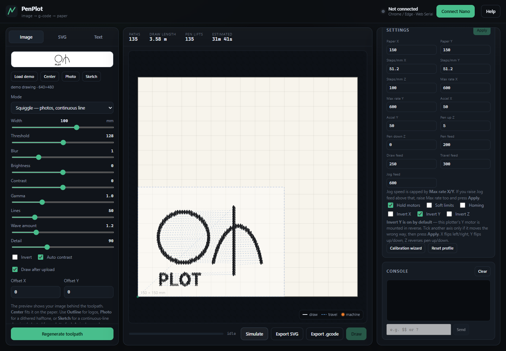

### 10. Any screen

The layout reflows for phones and tablets: the canvas first, then source
controls, then machine controls. Design and export work everywhere; live USB
drawing needs desktop Chrome/Edge.

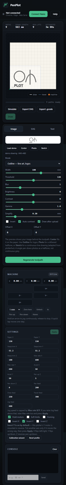

---

## Feature matrix

| Stage | Feature | What it does |
| --- | --- | --- |
| **Image** | Outline trace | Threshold + marching-squares contour tracing, blur, auto-contrast, simplification. Best for logos and line art. |
| | Sketch / Squiggle | One continuous wavy line per row, amplitude driven by tone. Adapted from plotterfun. |
| | Scan lines | Horizontal raster strokes, optional dither and gap bridging. |
| | Vertical hatch | The same raster conversion rotated 90°. |
| | Dots / stipple | Short dot strokes per dark cell for portraits and texture. |
| | Photo preset | Scan lines + Floyd–Steinberg dither + one-way rows in one click. |
| | Tone controls | Threshold, auto contrast, brightness, contrast, gamma, invert. |
| | Dithering | Floyd–Steinberg error diffusion or ordered Bayer 4×4. |
| | Preview underlay | The source image is drawn behind the toolpath, like LaserGRBL/UGS. |
| | Fit & offset | Width in mm, **Center** fit, manual X/Y offsets, paper-edge clipping. |
| **SVG** | Import | Paths, circles, ellipses, rects, polygons, polylines, lines, groups, transforms. |
| | Flatten | Bézier adaptive flattening with adjustable curve tolerance. |
| | Scale | Width in mm, offsets, paper clamping. |
| **Text** | Hershey font | True single-stroke letters, not outlined fonts. |
| | Layout | Height, letter spacing, line spacing, alignment, rotation ±45°, X/Y offset. |
| **CAM** | Canvas preview | Paper rectangle, toolpath, image underlay, dashed bounds. |
| | Simulation | Animated playback of the toolpath without hardware. |
| | Statistics | Paths, draw length, pen lifts, estimated draw/travel/Z time. |
| | Export G-code | Full GRBL program as a `.gcode` file. |
| | Export SVG | Plots the current toolpath as a millimetre-scale SVG for jscut/Inkscape/other CAM. |
| | Path optimisation | Dedupe, ordering, travel reduction, gap connection, clipping. |
| **Machine** | Web Serial | Direct browser → USB serial, no driver app or daemon. |
| | Connect | Port picker, auto-reconnect to a previously allowed port. |
| | Status | Real-time GRBL status: Idle/Run/Jog/Alarm, WPos, feed, spindle. |
| | Hold-to-jog | Press and hold an arrow for continuous `$J` movement; release to stop. A quick tap moves one step. |
| | Steps | 0.1 / 1 / 10 / 50 mm. |
| | Zero | `G10 L20 P1 X0 Y0 Z0` work-origin zero at the paper corner. |
| | Pen control | Pen up/down to configured Z heights. |
| | Pause/Resume | GRBL feed-hold `!` and cycle-start `~`. |
| | Stop | Abort stream, soft-reset, lift pen. |
| | Live crosshair | Real machine position in WPos, cached WCO, pinned to the canvas edge when outside. |
| | Console | Any GRBL command, multi-line replies collected. |
| | Auto-draw | Optional 5-second countdown after upload when the Nano is connected. |
| **Settings** | Profile | Paper, steps/mm, max rate, acceleration, pen heights, feeds, hold motors. |
| | EEPROM | **Apply** writes the profile to GRBL; **↻** reads `$$` back. |
| | Calibration | Steps/mm wizard and pen-height capture. |
| | Inversion | `$3` X/Y/Z direction mask, with Y inverted by default for this build. |
| | Persistence | Settings saved in `localStorage`, so the panel survives reloads offline. |
| **Platform** | No backend | Static HTML/CSS/JS; all parsing, tracing and streaming is client-side. |
| | Any OS | Windows, macOS, Linux, ChromeOS, Android, iOS — for design/preview/export. |
| | Responsive | Desktop three-column layout and mobile stacked layout. |
| | Offline-capable source | The app is a static site; serve the folder anywhere. |

---

## The pipeline in code

### G-code generation

`buildGcode` is deliberately small and deterministic: every stroke becomes a
`G0` travel, a pen-down `G1 Z`, a sequence of `G1` XY moves, then a pen-up.

```js
// js/gcode.js
lines.push('G21 ; millimetres', 'G90 ; absolute', 'G94 ; mm per minute');
lines.push(`G0 Z${up} ; pen up`, `G4 P${Math.min(dwell, 1).toFixed(2)}`);

for (const path of paths) {
  const first = path.points[0];
  lines.push(`G0 X${f3(first.x)} Y${f3(first.y)}`);
  lines.push(`G1 Z${down} F${penFeed}`);
  if (dwell > 0) lines.push(`G4 P${dwell.toFixed(2)}`);
  let feedSet = false;
  for (let i = 1; i < path.points.length; i++) {
    const pt = path.points[i];
    if (!feedSet) {
      lines.push(`G1 X${f3(pt.x)} Y${f3(pt.y)} F${drawFeed}`);
      feedSet = true;
    } else {
      lines.push(`G1 X${f3(pt.x)} Y${f3(pt.y)}`);
    }
  }
  lines.push(`G1 Z${up} F${penFeed}`);
}
```

A generated program looks like this:

```gcode
G21 ; millimetres
G90 ; absolute
G94 ; mm per minute
G0 Z5 ; pen up
G4 P0.20
G0 X0.000 Y13.281
G1 Z0 F200
G4 P0.20
G1 X1.094 Y15.000 F250
G1 X2.344 Y16.250
G1 X2.969 Y17.500
...
G1 Z5 F200
G4 P0.20
G0 Z5
M5
```

### Web Serial streaming

Each line waits for GRBL's `ok` before the next is sent. This line-by-line
handshake is slower than character-counting streaming, but it is dramatically
more reliable on a 28BYJ-48 plotter and makes errors point at the exact line.

```js
// js/serial.js
async stream(lines, { onProgress, shouldStop } = {}) {
  this._streaming = true;
  this._abort = false;
  const total = lines.length;
  try {
    for (let i = 0; i < total; i++) {
      if (this._abort) throw new Error('Stopped');
      if (shouldStop && shouldStop()) throw new Error('Stopped');
      const line = lines[i];
      if (!line || line.startsWith(';') || line.startsWith('(')) continue;
      try {
        await this.sendLine(line, 30000);
      } catch (err) {
        const short = line.length > 60 ? `${line.slice(0, 60)}…` : line;
        throw new Error(`${err.message} (line ${i + 1}: ${short})`);
      }
      if (i % 3 === 0) this.writeRaw('?').catch(() => {});
      if (onProgress && (i % 10 === 0 || i === total - 1)) {
        onProgress(i + 1, total);
      }
    }
  } finally {
    this._streaming = false;
    this._abort = false;
  }
}
```

### Hold-to-jog

A press starts one long relative jog; releasing sends GRBL's jog cancel. A tap
shorter than 220 ms is treated as a single discrete step instead.

```js
// js/main.js
const JOG_HOLD_MS = 220;

async function startContinuousJog(press) {
  press.active = true;
  const dir = press.sign === '+' ? 1 : -1;
  const dist = (press.axis === 'X' ? profile.travel.x : profile.travel.y) * dir;
  const axisMax = press.axis === 'X' ? profile.maxRate.x : profile.maxRate.y;
  const feed = Math.max(1, Math.min(profile.feed.jog || 600, axisMax));
  await serial.sendLine(`$J=G91 ${press.axis}${dist.toFixed(3)} F${feed.toFixed(0)}`, 30000);
}

function endJogPress() {
  if (press.active) {
    serial.jogCancel().catch(() => {}); // GRBL decelerates to a stop
  } else {
    jog(press.axis, press.sign);        // quick tap = one step
  }
}
```

### SVG export from the toolpath

The current toolpath is re-emitted as a millimetre-scale SVG, so the same job
can be opened in jscut, Inkscape, LaserWeb or any other CAM package.

```js
// js/main.js
function exportSvg() {
  const work = profile.work;
  let d = '';
  for (const path of state.paths) {
    const pts = path.points;
    d += `M${f(pts[0].x)} ${f(work.y - pts[0].y)}`;
    for (let i = 1; i < pts.length; i++) {
      d += `L${f(pts[i].x)} ${f(work.y - pts[i].y)}`;
    }
  }
  const svg = `<svg xmlns="http://www.w3.org/2000/svg"
    width="${work.x}mm" height="${work.y}mm"
    viewBox="0 0 ${work.x} ${work.y}">
    <path d="${d}" fill="none" stroke="#000" stroke-width="0.25"/>
  </svg>`;
  // download as penplot.svg
}
```

### Image tracing

Outline mode thresholds the image, traces the mask with marching squares,
simplifies the polyline and emits closed contours as continuous strokes.

```js
// js/image.js (shape of the pipeline)
const { gray } = imageToGray(img, w, h);
const toned = applyTone(autoLevels(gray), { brightness, contrast, gamma });
const blurred = boxBlur(toned, w, h, blur);
const mask = threshold(blurred, threshold, invert);
const paths = traceMask(despeckle(mask, w, h), w, h, {
  simplify: simplifyMm / cell,
  minLength: 3
});
```

---

## Compatibility

| Capability | Windows | macOS | Linux | ChromeOS | Android | iOS/iPadOS |
| --- | --- | --- | --- | --- | --- | --- |
| Design / image import | ✅ | ✅ | ✅ | ✅ | ✅ | ✅ |
| SVG import / text | ✅ | ✅ | ✅ | ✅ | ✅ | ✅ |
| Preview / simulation | ✅ | ✅ | ✅ | ✅ | ✅ | ✅ |
| Export SVG / G-code | ✅ | ✅ | ✅ | ✅ | ✅ | ✅ |
| Live USB drawing (Web Serial) | Chrome/Edge | Chrome/Edge | Chrome/Edge | Chrome/Edge | ❌ | ❌ |

- **Any device and OS** covers the whole design, preview and export workflow.
- **Live machine control** uses the Web Serial API. Firefox and Safari do not
  implement it, and mobile browsers do not expose USB serial to web pages. Use
  desktop Chrome or Edge for the final USB connection.
- Web Serial also requires a secure context: the HTTPS hosted app, or
  `http://localhost`. Opening `index.html` as `file://` will not work.
- The site is a static bundle (HTML + CSS + ES modules), so it can be hosted on
  Vercel, GitHub Pages, Netlify, a Raspberry Pi or any static server.

---

## Quick start

1. Open **<https://adithya-in.github.io/penplot/>** in desktop Chrome or Edge.
2. Flash the Nano once (see [Flash the Nano](#flash-the-nano)).
3. Click **Connect Nano**, pick the CH340/FT232 port, wait for **Idle**.
4. Press **Settings → Apply** once to write the machine profile.
5. Jog to the **bottom-left** corner of the paper, lower Z until the pen just
   touches, then press **Zero here**.
6. Load an image, an SVG or text, press **Center**, check the preview, then
   press **Draw**.

There is **no backend** and no upload: your image never leaves the browser.

---

## What you need

**Hardware**

| Part | Notes |
| --- | --- |
| Arduino Nano (ATmega328P) | Clones with a CH340 USB chip are fine. |
| 3 × 28BYJ-48 stepper | 5 V unipolar, with the small gearbox. |
| 3 × ULN2003 driver board | One per motor, with the 4-pin motor connector. |
| 5 V power supply, ≥ 2 A | **Separate** supply for the motors. |
| USB cable | Must be a **data** cable, not charge-only. |
| Plotter frame, belts, pen holder | X/Y move the pen; Z raises and lowers it. |

No limit switches are required. The app clamps every toolpath to the paper
rectangle and never enables homing or soft limits by default.

**Software**

- Desktop [Chrome](https://www.google.com/chrome/) or Edge for Web Serial.
  Firefox, Safari and mobile browsers can design and export but cannot talk to
  the Nano.
- **For the hosted app:** nothing else.
- **For flashing:** Windows 10/11 and
  [arduino-cli](https://arduino.github.io/arduino-cli/):
  `winget install --id ArduinoSA.CLI -e`
- Python 3 is only needed for the optional local `start.bat`.
- Node.js is **not** required to run the app. It is only used to regenerate the
  README screenshots (`npm run screenshots`).

---

## Wiring

The firmware is the **GRBL-28byj-48** fork. It drives the ULN2003 boards
directly with an 8-state half-step sequence, so the usual step/dir pins are not
used the way a normal GRBL CNC shield is.

### Stepper coils → Nano pins

| Axis | ULN2003 input | Nano pin | Port bit |
| --- | --- | --- | --- |
| **X** | IN1 | **D2** | PD2 |
| **X** | IN2 | **D3** | PD3 |
| **X** | IN3 | **D4** | PD4 |
| **X** | IN4 | **D5** | PD5 |
| **Y** | IN1 | **A0** | PC0 |
| **Y** | IN2 | **A1** | PC1 |
| **Y** | IN3 | **A2** | PC2 |
| **Y** | IN4 | **A3** | PC3 |
| **Z** | IN1 | **D8** | PB0 |
| **Z** | IN2 | **D9** | PB1 |
| **Z** | IN3 | **D12** | PB4 |
| **Z** | IN4 | **D13** | PB5 |

Connect each ULN2003 board's `IN1…IN4` header to the pins above. The motor
connector on the board accepts the 28BYJ-48 plug directly — do not swap the
wires unless you are deliberately reversing a direction.

### Power and ground

```text
  USB ────────────── Arduino Nano ──── D2..D5, A0..A3, D8, D9, D12, D13
                        │  GND                     │
                        └────────────┬─────────────┘
                                     │  (common ground)
  5 V ≥ 2 A supply ──── +5 V ──┬── ULN2003 #1 (X)
                               ├── ULN2003 #2 (Y)
                               └── ULN2003 #3 (Z)
                      GND ─────┴── all three boards + Nano GND
```

Rules that matter:

- **Do not power the motors from the Nano's 5 V pin.** Three 28BYJ-48 motors
  can pull well over 1 A; the Nano's regulator and USB port cannot supply that.
- **Join the grounds.** The motor supply ground, all three ULN2003 grounds and
  the Nano ground must be connected, or the drivers will behave erratically.
- Power the Nano from USB while drawing. If you also power it from the external
  supply, do not connect both 5 V sources together.
- Add a 100 µF electrolytic capacitor across +5 V/GND near the driver boards if
  the motors cause resets or dropped serial characters.

### Direction

The plotter in the PCBWay build has its **Y motor mounted in reverse**, so this
firmware and the web app start with `$3=2` (invert Y). X and Z stay normal, and
the drawing comes out the right way up when you zero at the **bottom-left**
corner of the paper.

If an axis still moves the wrong way, either tick it in **Settings → Invert
X / Y / Z** and press **Apply**, use the console, or flip its motor connector /
swap two coil wires. `$3=1` inverts X, `2` Y, `4` Z; values add up. The
Settings card shows which bits are currently set.

> Older builds of this fork toggled the `$3` mask on every step pulse, which made
> an inverted axis vibrate in place. That bug is fixed in the vendored firmware:
> re-flash if you have an older `.hex`.

---

## Flash the Nano

1. Plug the Nano into USB. Windows should create a COM port. Most clones need
   the CH340 driver; genuine boards use FT232.
2. Double-click **`flash.bat`** (or run `.\flash.ps1` in PowerShell).

The script:

- finds `arduino-cli` (or explains how to install it),
- installs the `arduino:avr` core once if it is missing,
- lists the COM ports and asks which one is the plotter,
- compiles the vendored GRBL source in `firmware/`,
- uploads using the **old bootloader** setting first, then retries with the new
  bootloader automatically.

Useful options:

```powershell
.\flash.ps1 -Port COM3          # skip the port prompt
.\flash.ps1 -NewBootloader      # 115200-baud Nano bootloader
.\flash.ps1 -Monitor            # open a 115200 serial monitor afterwards
```

Expected build size is **about 29,910 bytes (97 % of flash)** with about
**1,554 bytes of RAM** in use. The `Low memory available` warning is normal for
this fork; it still runs. If the upload fails, close the Arduino IDE, Cura,
PuTTY or anything else holding the COM port.

The script tries the old bootloader first and automatically retries with the new
one. A board that reports `not in sync: resp=0xa3` on the first attempt is a new
bootloader Nano; the second attempt succeeds.

After flashing, open `flash.ps1 -Monitor` and press Enter. You should see a
`Grbl 1.1f [...]` banner and an `ok` after `$$`.

---

## First-run workflow

1. **Connect Nano** and confirm the status dot turns green and the machine pill
   shows **Idle**.
2. **Settings → Apply** once after flashing. This writes the profile, including
   **Y inversion** (`$3=2`), the **600 mm/min** max-rate/jog cap, and your
   calibrated steps/mm, to the controller's EEPROM. Keep **Invert Y** ticked —
   the Y motor on this plotter is mounted in reverse.
3. Jog X/Y with the arrows until the pen is over the **bottom-left corner** of
   the drawing area. Use the 10 mm step first, then 1 mm. Hold an arrow for
   continuous movement; release to stop.
4. Jog Z down until the pen **just touches** the paper.
5. Press **Zero here**. This sets the work origin to `X0 Y0 Z0` at the paper
   corner and the touch point. The X/Y/Z boxes now show **work coordinates**,
   so they read `0.00` after zeroing.
6. Set **Pen down Z = 0** and **Pen up Z = 3–5 mm** (or use
   **Calibration wizard** now: *Capture as DOWN* reads 0, lift, *Capture as
   UP*). Press **Apply**.
7. Load an image (or the demo), press **Center**, check the preview, and press
   **Draw**. Start with a small, simple drawing and a low draw feed.

The machine has no limit switches. The app prevents coordinates outside the
paper rectangle by clamping them, but it cannot know where the physical carriage
is until you zero it at a known corner.

### Setting 0,0 without homing

There is no `$H` homing cycle on this plotter. **0,0 is wherever you put the
pen and press Zero here** — normally the bottom-left corner of the drawing
area. The app's coordinate display is **WPos** (work position), not the
controller's internal machine position.

- **Make a physical corner stop.** Tape two thin strips (or a printed L-bracket)
  at the bottom-left of the paper area. Each session, push the carriage gently
  into the stop, then press **Zero here**. This is your repeatable "home".
- **Re-zero after every power cycle or USB reconnect.** GRBL has no absolute
  position sensor; on boot it assumes machine position 0 wherever the carriage
  happens to be. The saved work offset is kept in EEPROM, but it cannot restore
  the physical corner.
- The **Home** button is intentionally blocked because homing is disabled and
  there are no switches. Do not send `$H`.

---

## Drawing modes

### Image — Outline

Best for logos, line art and high-contrast drawings. The image is thresholded,
optionally blurred, traced with marching squares, simplified and optimised.
`Simplify` controls how aggressively the outline is reduced (larger = fewer
points). Closed contours are plotted as one continuous line.

The centre preview draws the uploaded image **underneath** the toolpath, the way
LaserGRBL and UGS visualise a raster job, so you can see exactly what will be
plotted before sending it. The dashed blue rectangle is the image boundary.
**Center** fits the image to the paper and centres it; `Offset X/Y` places it
manually.

If the image is a photo, the app detects the mid-grey tones and switches to
**Sketch** (continuous Squiggle), because one line per row is far kinder to a
28BYJ plotter than hundreds of dithered strokes. Press **Photo** for a
**Scan lines + Dither** halftone instead. Press **Outline** for logos and line
art. A newly uploaded logo switches back to Outline automatically; manually
choosing a mode stops the automatic switching.

A single-colour pen cannot reproduce continuous grey. Photos are drawn as a
**halftone**: dithered black dots/segments that the eye blends into shades.
Expect an artistic approximation, not a photocopy.

- **Threshold** works in the intuitive direction: higher = more ink.
- **Auto contrast** stretches a washed-out photo to the full black-to-white
  range. Keep it on for phone photos; turn it off if the original contrast is
  intentional.
- **Brightness / Contrast / Gamma** apply before thresholding/dithering, the
  same order LaserWeb4 and LaserGRBL use. Gamma is the most useful control for
  lifting or deepening midtones.
- **Dither** converts greys into a fine black/white pattern; leave it on for
  photos.
- **Ordered** uses a regular Bayer 4×4 pattern instead of error diffusion. Try
  it when Floyd–Steinberg looks too noisy.
- In solid areas, adjacent raster runs that overlap are joined into one
  zig-zag path (the same idea as GRBL-Plotter's fill). This greatly reduces pen
  lifts and the blobs/backlash they cause. **Connect rows** is automatically
  disabled whenever **Dither** or **Ordered** is on, because joining dithered
  runs would smear the image.
- Paths are **clipped** at the paper edge, not dragged along it. An oversized
  image is cut off cleanly instead of drawing a border line.
- **One-way scan** draws every row left-to-right instead of snaking. It is
  slower (the pen returns across the row) but removes the horizontal stripes
  caused by backlash in the 28BYJ gearboxes and belts.
- For the most detail, use **Dots** with `Dither` and `Line spacing` 0.6–0.8 mm.
  It is slow because the pen lifts between dots.

### Image — Sketch (Squiggle)

Adapted from [mitxela/plotterfun](https://github.com/mitxela/plotterfun) (MIT).
It draws **one continuous wavy line per row**. Dark pixels get a larger wave
amplitude and a faster oscillation; light areas flatten out or are skipped.
Because there is only one pen lift per row, this is much faster and cleaner on a
slow 28BYJ plotter than hundreds of dithered segments.

- **Lines** — number of rows (10–200). More lines = more detail and longer plot.
- **Wave amount** — how far the line swings (0.1–5).
- **Detail** — wave frequency (5–256). Lower = smoother, higher = denser texture.

Press **Sketch** to apply the preset. It is an artistic line drawing, not a
photocopy; use **Photo** (halftone) for a more photographic result.

### Image — Scan lines

Converts the image to horizontal strokes, one per raster line. Best for photos
and solid shapes. Adjust `Line spacing` (smaller = more detail and much longer
draw time), `Threshold`, `Dither` for photos, and `Bridge gaps` to join small
breaks in a scan line.

If the result is a black blob, the threshold is too high or the image has a dark
background — tick **Invert**. If it is all white, lower the threshold.

### Image — Vertical hatch

The same raster conversion rotated 90°. Use it when horizontal lines fight with
the image content or when you want a cross-hatched look by plotting the same
image twice with different spacing.

### Image — Dots (stipple)

Produces short dot strokes per dark cell. Works well for portraits and textures;
it produces many pen lifts, so it is slower.

`Invert` swaps ink and paper. `Width` scales the output to a physical width in
millimetres; `Offset X/Y` positions it on the page.

### SVG

Imports SVG paths, shapes, polylines, polygons and lines, flattens Bézier
curves, applies element transforms and scales the drawing to the requested
width in millimetres. Filled shapes are plotted as **outlines** — for a
single-stroke look, export the SVG with strokes only and no fills.
`Curve tolerance` simplifies imported curves; larger is faster and rougher.
SVGs larger than the paper are scaled to the requested width and clamped.

### Text

Uses a single-stroke Hershey font, so letters are drawn in one pass like a
technical pen. Controls: letter height (mm), letter spacing, line spacing,
alignment, rotation ±45°, and page offsets. Text is kept in reading order rather
than travel-optimised.

### Draw-after-upload

The **Draw after upload** checkbox is on by default. When an image is loaded,
the app generates the toolpath and, if the Nano is connected and the path is
inside the paper, opens the confirmation dialog with a **5-second countdown**.
Press **Cancel** to stop it. Auto-draw is skipped when the machine is offline or
the path needed clamping.

---

## Settings and calibration

The right-hand **Settings** card holds the machine profile:

| Setting | Meaning | Default |
| --- | --- | --- |
| Paper X / Y | Usable paper area, mm | 150 × 150 |
| Steps/mm X / Y / Z | Motor calibration | 51.2 / 51.2 / 100 |
| Max rate X / Y | Maximum axis speed, mm/min (also caps jog) | 600 / 600 |
| Accel X / Y | Acceleration, mm/s² | 50 / 50 |
| Pen up Z / Pen down Z | Z heights for pen lift | 5 / 0 |
| Pen feed | Z move speed, mm/min | 200 |
| Draw feed | XY speed while drawing | 250 |
| Travel feed | XY speed while moving with pen up | 300 |
| Jog feed | XY speed for the jog arrows (capped by Max rate) | 600 |
| Hold motors | Keep coils energised when idle | on |
| Soft limits | GRBL soft limits | off |
| Homing | GRBL homing cycle | off |
| Invert X / Y / Z | Direction of each axis (`$3`) | **Y on**, X/Z off |

- **Apply** writes the profile to the Nano when connected (`$$` dumps the
  current values in the console). Settings are saved in the browser as soon as
  you edit them, so the panel survives a reload even while offline.
- **↻** reads `$$` back from the controller into the panel.
- **Reset profile** restores the built-in defaults.
- **Calibration wizard** corrects steps/mm and captures pen heights.

### Calibrating steps/mm

The most accurate method uses a long move in the Console. The wizard uses a
10 mm move, which magnifies measurement error.

1. Mark a start point on the carriage or belt.
2. With the pen **up**, zero X (or note the current X) and send:

   ```gcode
   G21 G90
   G1 X100 F300
   ```

3. Measure the real distance travelled.
4. Calculate:

   ```text
   new steps/mm = old steps/mm × 100 ÷ measured
   ```

   Example: `51.2 × 100 ÷ 98.0 = 52.24`.
5. Enter the result in **Steps/mm X**, press **Apply**, and repeat for Y with
   `G1 Y100 F300`.
6. For Z, command `G1 Z10 F100`, measure the lift, and use the same formula
   with **Steps/mm Z**.

The wizard does the same calculation for a 10 mm move: jog exactly 10 mm,
measure it, enter the measured value, and press **Apply X/Y**.

The 51.2 steps/mm default corresponds to roughly 4096 half-steps per output
revolution over 80 mm of belt travel. Your pulley, belt and motor may differ —
always calibrate.

### Pen height

Zero the machine at the **touch point** first (see the first-run workflow), then:

- **Pen down Z = 0** — the tip just touches the paper.
- **Pen up Z = 3–5 mm** — enough to clear the paper during travel.

Alternatively, with the pen touching, open **Calibration wizard → Capture as
DOWN** (the box now shows work Z `0.00`), lift the pen a few millimetres, then
**Capture as UP**. Press **Apply** to store it.

The pen must be **up** for every travel move and **down** only while drawing.
Verify with **Pen up** / **Pen down**. If Z moves the wrong way, tick **Invert
Z** and press **Apply**. If the pen presses too hard or misses lines, adjust
**Pen down Z** by 0.1–0.2 mm.

### Suggested conservative first run

- Draw feed **100–150 mm/min**
- Max rate **600 mm/min** (jog/travel cap; lower it if a jog skips)
- Accel **30–50 mm/s²**
- Image width **50–80 mm**
- Raster spacing **1.5–2 mm**

28BYJ-48 motors are slow and have low torque at speed. If they skip steps or
buzz, lower the feed and acceleration.

---

## Machine controls and console

- **Jog arrows** move X/Y by the selected step (0.1, 1, 10 or 50 mm) at
  **Jog feed** (600 mm/min by default). **Hold** an arrow for continuous
  movement and release to stop; a quick tap moves one step. GRBL caps this at
  **Max rate X/Y**; both are in Settings and need **Apply** to reach the
  controller.
- **Zero here** sets the work origin (`G10 L20 P1 X0 Y0 Z0`).
- **Unlock** clears a GRBL alarm (`$X`).
- **Pen up / Pen down** move Z to the configured heights.
- **Home** is intentionally blocked unless homing is enabled; there are no limit
  switches.
- **Simulate** plays the toolpath on the preview without moving the machine.
- **Export SVG** downloads the toolpath as a millimetre-scale SVG.
- **Export .gcode** downloads the generated program.
- **Stop** aborts the stream, soft-resets the controller and lifts the pen.
- **Pause / Resume** sends GRBL feed-hold (`!`) and cycle-start (`~`).
- The orange crosshair in the preview is the **live machine position** in work
  coordinates (`WPos`). It updates while jogging and while drawing. It uses a
  cached WCO offset, so it stays on the drawing instead of jumping to machine
  coordinates. If the machine is outside the paper, the marker is pinned to the
  edge with an arrow and shows its real coordinates.

The **Console** accepts any GRBL command: `?`, `$$`, `$#`, `$G`, `$X`, `$H`,
`G0 X10`, etc. Multi-line replies (`$$`, `$#`, `$I`, `$G`) are collected and
logged. Do not send a reset (`Ctrl-X`) while streaming; use the Stop button.

### Alarms

**ALARM** is GRBL's safety lock, not a fault in the app. GRBL enters it when a
hard limit is hit (if enabled), a soft limit is exceeded, homing fails, a probe
fails, or a reset happens during homing. While the lock is active, normal
G-code is refused with `error:9`.

This plotter has **no limit switches**, so the alarm sources must stay off:

| Setting | Value | Why |
| --- | --- | --- |
| Soft limits `$20` | `0` | A move outside 0–150 mm would alarm |
| Hard limits `$21` | `0` | Floating limit pins would alarm constantly |
| Homing `$22` | `0` | There are no switches to home against |

In the app, untick **Soft limits** and **Homing** in Settings and press
**Apply**. Then press **Unlock** (sends `$X`) to clear the alarm.

If the alarm returns immediately:

- Send `$$` in the Console and check that `$20=0`, `$21=0`, `$22=0`.
- Send `?` to see the machine state and `Pn:` field. `Pn:PXYZ` by itself is
  just the (unused) pin states — it is not an alarm.
- Stay inside `0…150 mm` in X/Y and `0…15 mm` in Z. The app clamps toolpaths,
  but manual Console moves are not clamped.
- Do not type G-code while a jog is moving; wait for **Idle**.
- After a power glitch or a reset during a move, press **Unlock** and zero
  again at the paper corner.

The red **ALARM** pill and the toast in the app mean the controller is locked.
Press **Unlock** first; then fix the setting that re-triggers it.

---

## Troubleshooting

| Symptom | Fix |
| --- | --- |
| **Connect Nano** does nothing / no port picker | Use desktop Chrome or Edge, not Firefox/Safari/mobile. Use the HTTPS hosted app, or `http://localhost:8080` locally — not `file://`. Close other apps that hold the port. |
| No COM port in Windows | Try another USB **data** cable/port; install the CH340 driver for clones; check Device Manager for a yellow warning. |
| Upload fails | Close the Arduino IDE/serial monitor. Try `.\flash.ps1 -NewBootloader` or the other bootloader setting. Some clones need a manual reset at "Uploading". |
| GRBL banner appears but motors do not move | Press **Settings → Apply** to write steps/mm and rates. Check the common ground and the external 5 V supply. |
| **Draw** does nothing or stops immediately | Reload the page after flashing (Ctrl+Shift+R) and reconnect. Wait for the green **Idle** pill, then press Draw. If it still stops, the Console shows the failing G-code line and error. |
| Browser says Connected but the board ignores everything | After a flash the COM port was reopened by avrdude. Click **Disconnect**, then **Connect Nano** again, or reload the page. |
| `error:9` / alarm on connect | The controller is in an alarm state. Press **Unlock** (`$X`). Then untick **Soft limits** and **Homing** and press **Apply**; homing/soft limits must stay off on this plotter. |
| ALARM comes back after Unlock | Send `$$` and confirm `$20=0`, `$21=0`, `$22=0`. Also check that the move is inside 0–150 mm X/Y and 0–15 mm Z. `Pn:PXYZ` alone is not an alarm. |
| Motors buzz but do not turn | Coil order or a loose ULN2003 connector. Verify X D2–D5, Y A0–A3, Z D8, D9, D12, D13. Reduce feed/accel. |
| Axis moves the wrong direction | Tick the axis under **Settings → Invert X/Y/Z** and press **Apply** (`$3=1` X, `2` Y, `4` Z), or flip the motor connector. |
| Drawing is mirrored / upside down | The machine origin is the **bottom-left** corner. Zero there. Y is inverted by default (`$3=2`) for this plotter — do not untick **Invert Y** unless your Y motor is mounted the other way. |
| Pen drags on travel moves | Increase `Pen up Z`, verify Z direction, and check that the pen holder is not binding. |
| Skipped steps / shifted drawing | Lower draw feed and acceleration; check belt tension, pulley set screws and motor supply current. A 28BYJ-48 has very little torque. |
| Disconnects mid-drawing | Use a shorter/quality USB cable, add the 100 µF capacitor, and keep the motor supply wiring away from the USB cable. |
| Nothing fits on the paper | Check `Paper X/Y`, image offsets and width. The warning banner tells you which axis is outside; the app clamps automatically. |
| Image trace looks like random lines or almost nothing | Use **Scan lines** or **Dots** for a photo; **Outline** is only for logos and line art. The preview shows the source image behind the paths so you can check the fit. |
| Photo comes out as black/white stripes or a blob | Press **Photo** (Scan + Dither, 0.8 mm, one-way). Lower **Threshold** or tick **Invert** if the background is dark. A single pen cannot make continuous grey — dithered halftone is the closest result. |
| Photo looks like a mesh or scribble | Press **Photo** for the halftone version, or reduce **Lines**, **Wave amount** and **Detail** in **Sketch** mode. |
| Rows are shifted or the image looks torn | Turn on **One-way scan**, lower draw feed/accel, and check belt tension and pulley set screws. 28BYJ gearboxes have backlash; serpentine rows exaggerate it. |
| Image is too coarse / missing detail | Use a larger **Width**, `Line spacing` 0.6–0.8 mm, and **Dots** + **Dither**. Use a finer pen. |
| Image extends beyond the paper | The app clips the toolpath at the edge instead of dragging it along the border. Reduce **Width** or press **Center**. |
| Image is not centred on the paper | Press **Center** in the Image tab. It fits the image inside the paper and sets both offsets. |
| Text appears upside down or off the page | Text uses a top-left origin; increase `Offset Y (top)` and check rotation. |
| Auto-draw starts before I am ready | Untick **Draw after upload**, or press **Cancel** during the 5-second countdown. |

Reset a stuck controller without the app: unplug USB, wait two seconds, plug it
back in, reconnect, then **Unlock**.

---

## Safety

- Three 28BYJ-48 motors plus three ULN2003 boards get warm. Keep them ventilated
  and do not leave the machine powered unattended with `Hold motors` on.
- The plotter has **no limit switches**. Always zero at a known corner and keep
  the paper area smaller than the mechanical travel.
- Keep fingers, hair and cables clear of belts and the pen mechanism.
- Test a new drawing with the pen lifted or with the motor power off, watching
  the preview first.
- Use a separate, fused 5 V supply for the motors; never back-feed the Nano's
  5 V pin.
- If anything jams, press **Stop** or cut motor power. Do not pull the USB cable
  while the motors are moving if you can avoid it.

---

## Project layout

```text
index.html                 app shell and UI
css/styles.css             styling and responsive layout
js/main.js                 UI state machine, workflow, jog, export
js/serial.js               Web Serial transport + ok-handshake streaming
js/grbl.js                 GRBL commands (settings, jog, pen, zero, unlock)
js/settings.js             machine profile + localStorage persistence
js/image.js                image → trace/raster/dot/squiggle paths
js/trace.js                marching-squares contour tracing + simplification
js/svg.js                  SVG import, transforms, Bézier flattening
js/font.js + js/hershey.js single-stroke Hershey text
js/pathopt.js              path ordering / travel optimisation
js/gcode.js                bounds checking, G-code generation, statistics
js/preview.js              canvas preview and simulation
docs/screenshots/          README screenshots, generated by Playwright
scripts/screenshots.mjs    Playwright screenshot generator
package.json               dev scripts (screenshots, local serve)
firmware/lib/grbl/         vendored GRBL 28BYJ-48 firmware source
firmware/sketch/           Arduino sketch used to build/upload GRBL
firmware/COPYING           GPLv3 licence for the firmware
flash.ps1 / flash.bat      compile + upload the firmware
start.bat                  local static server + browser launcher
vercel.json                static hosting config for Vercel
.vercelignore              keeps firmware/build/docs/tooling out of the deploy
```

### Develop and screenshot locally

```bash
npm install          # installs Playwright (dev only)
npm run serve        # static server on http://127.0.0.1:8099
npm run screenshots  # writes docs/screenshots/*.png
```

The screenshot script uses the system Chrome at
`C:\Program Files\Google\Chrome\Application\chrome.exe` by default; set
`CHROME_PATH` to use another Chrome/Chromium binary. It does not need a
Playwright browser download.

### Redeploy after changing the site

```powershell
npx vercel deploy --prod
```

The Vercel project is **penplot** under *adithya's projects*. `firmware/`,
`.build/`, the flashing scripts, `docs/`, `scripts/`, the README and
`package*.json` are excluded by `.vercelignore` and are not uploaded.

---

## Firmware provenance and licence

The firmware is **GRBL 1.1f**, modified for 28BYJ-48 unipolar steppers by
[TGit-Tech/GRBL-28byj-48](https://github.com/TGit-Tech/GRBL-28byj-48), vendored
here so flashing does not depend on the network. GRBL is Copyright (c) 2011–2017
Sungeun K. Jeon / Gnea Research LLC and is licensed under the **GNU GPLv3**.
See [`firmware/COPYING`](firmware/COPYING); if you redistribute a flashed board
or modified firmware, the GPLv3 obligations apply. The local modifications are
documented in [`firmware/README.md`](firmware/README.md).

The original plotter build this project was based on:
<https://www.pcbway.com/project/shareproject/Build_a_simple_3D_Arduino_Mini_CNC_Plotter_e2c3f905.html>

The Hershey font data is public domain.

The **Sketch** and **Auto contrast** image algorithms are adapted from
[mitxela/plotterfun](https://github.com/mitxela/plotterfun), which is MIT
licensed. The raster filter order (brightness/contrast/gamma) follows
[LaserWeb4](https://github.com/LaserWeb/LaserWeb4), and the run-linking fill
idea follows [GRBL-Plotter](https://github.com/svenhb/GRBL-Plotter). The rest of
the web app is original for this project.
